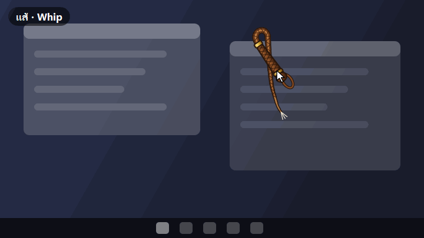
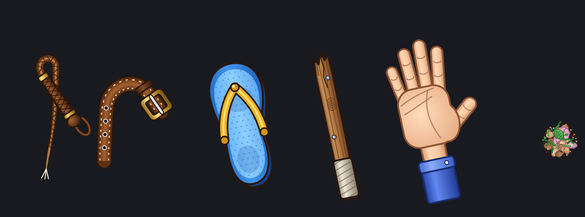
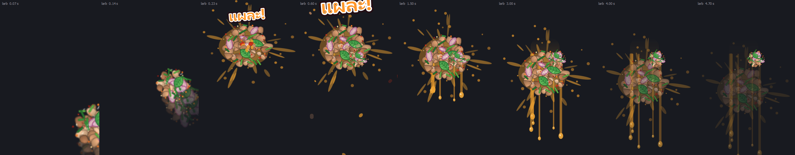
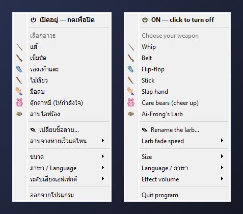

# SlapCursor

แอปเล่นๆ บน Windows: เลือกอาวุธจากไอคอนที่ system tray แล้วคลิกซ้ายตรงไหนก็ได้บนจอ
อาวุธจะฟาดลงพร้อมเสียงและข้อความเด้ง (แอปแค่วาดทับจอ คลิกยังทะลุไปถึงโปรแกรมข้างล่างตามปกติ)





## อาวุธ
| อาวุธ | physics |
|---|---|
| แส้ / เข็มขัด | เชือกจำลองแบบ Verlet มีแรงโน้มถ่วง แส้แตกตอนปลายเหยียดตึง |
| รองเท้าแตะ / ไม้เรียว / มือตบ | ของแข็งงอได้ตามแรง เงื้อ ฟาด เด้งกลับ |
| ตุ๊กตาหมี | ตามเมาส์แบบสปริง กระโดด หัวใจกระจาย |
| ลาบไอฟร้อง | ปาเข้าจอ แปะ ไหลลงช้าๆ แล้วจางหาย (ตั้งชื่อเองและปรับความเร็วจางได้) |



## ติดตั้งและเปิด
ต้องมี Python 3.10 ขึ้นไป บน Windows

```bash
pip install -r requirements.txt
```

แล้วดับเบิลคลิก `run.bat` หรือรัน `pythonw slap_cursor.py`

## ใช้งาน


- คลิกไอคอนที่ tray เพื่อเปิดเมนู: เปิด/ปิด, เลือกอาวุธ, ขนาด, ระดับเสียง, ภาษาไทย/English, ชื่อลาบ, ความเร็วลาบจาง
- `Ctrl+Shift+F12` เปิด/ปิดการทำงาน (โปรแกรมยังอยู่ใน tray)
- ตรวจหน้าตาโดยไม่เปิดหน้าต่าง: `python slap_cursor.py --selftest <โฟลเดอร์>` จะวาดทุกเฟรมลงรูป
- สร้างรูปตัวอย่างใน README ใหม่: `python tools/make_demo.py` (จำลองด้วย physics ตัวเดียวกับแอป ไม่ได้แคปหน้าจอจริง ต้องมี `pillow`)

## ความเป็นส่วนตัว
- ไม่ต่อเน็ต ไม่ส่งข้อมูลไปไหน
- อ่านสถานะปุ่มแค่ 4 ปุ่ม (คลิกซ้าย, Ctrl, Shift, F12) เพื่อรู้ว่าต้องฟาดหรือเปิด/ปิด ไม่บันทึกการพิมพ์
- ค่าที่ตั้งเก็บใน registry ที่ `HKCU\Software\SlapCursor`
- ถ้าติ๊ก "เปิดพร้อม Windows" ในเมนู จะเพิ่มค่าชื่อ `SlapCursor` ใน `HKCU\Software\Microsoft\Windows\CurrentVersion\Run` (ระดับผู้ใช้ ไม่ต้องใช้ admin) เอาติ๊กออกเมื่อไหร่ค่านี้ก็ถูกลบ
- ไฟล์เสียงสังเคราะห์ด้วยโค้ดเอง เก็บในโฟลเดอร์ `sounds/` ข้างตัวโปรแกรม
